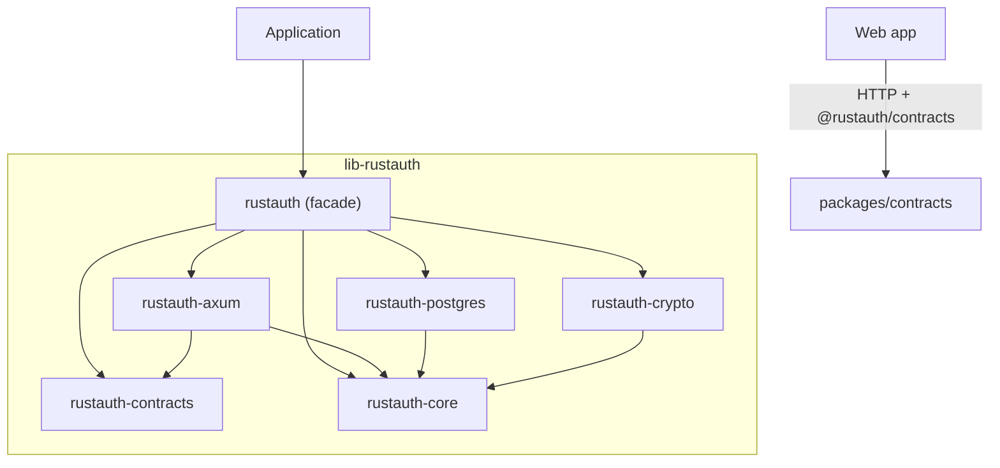

# ADR-001: Layered Crates and Storage in the `auth` Schema

## Status

Accepted

## Context

RustAuth is the shared authentication and authorization library for the owner's Rust applications (axum, sqlx, Postgres). Each application adds it as a Cargo git dependency, so a security fix or a new sign-in method lands once and reaches every application through an upgrade.

That shapes the architecture in four ways:

- **Many consumers, released separately.** The library ships on its own schedule while applications run older and newer versions. Its Rust API, HTTP API, and database schema need explicit compatibility rules.
- **Generic by design.** The library cannot know about any application. Application data stays in application tables that reference the library's users.
- **Growth without rewrites.** Two-factor, passkeys, SSO, and fine-grained permissions come later. v0.1 (username and password, sessions, roles) must leave room for them without reshaping its tables.
- **Same conventions as the applications.** The applications follow the clean/DDD layering of the RustInit template (pure domain crate, adapters around it, dependency rules checked by a script) and use its dependency versions. A library with a different shape or different crate versions would cost every application duplicate builds and a second set of habits.

## Decision

### Layered Crates

The workspace splits the library into a pure domain crate, adapter crates, and a facade:

- **`rustauth-core`** holds the domain: value objects, entities, the `Principal`, ports (`Clock`, `PasswordHasher`, `TokenIssuer`, `UserRepository`, `SessionRepository`), services, and `AuthError`. It depends on no HTTP, database, OpenAPI, TypeScript, or hashing crate and on no other rustauth crate, so every rule (setup token, first administrator, lockout, sliding expiry, last-administrator guard) is unit-tested with in-memory fakes.
- **Adapters implement ports or translate HTTP.** `rustauth-crypto` implements hashing and token issuing, `rustauth-postgres` implements the repositories, and `rustauth-axum` maps requests to core services and `AuthError` to HTTP. Adapters hold no domain rules, and `rustauth-axum` never touches storage or crypto directly.
- **`rustauth-contracts`** holds the request and response DTOs with OpenAPI schemas, and TypeScript derives under the `ts` feature. `packages/contracts` publishes the generated types plus Zod schemas as `@rustauth/contracts` for web apps.
- **The `rustauth` facade** is the composition root (`RustAuth::builder()` wires the adapters into the services) and the only supported Rust surface. It re-exports what applications need by name. The inner crates may change in any release, which keeps refactoring cheap without breaking consumers. Features `axum` and `postgres` (both on by default) and `ts` let an application leave out what it does not use.

Cargo already limits each crate to what its `Cargo.toml` lists; `make boundaries` checks that those lists never cross a forbidden edge (the table in the design, plus "the example uses the facade only" and "no `reqwest`").

### Storage

- **Postgres through sqlx on the application's pool.** The library takes a `PgPool`: the application's own (same database, so application tables can declare foreign keys to `auth.users`) or one to a separate database. The application owns the pool, so it also picks the TLS backend; the library enables no sqlx TLS feature.
- **One schema, owned by the library.** Every table lives in the `auth` schema. Applications never read or write `auth` tables directly; they use the library's services and routes. The one stable database contract is `auth.users (id uuid primary key)`, which no release renames, retypes, or drops.
- **A separate migration history.** The migrations are embedded in `rustauth-postgres` and tracked in `auth._sqlx_migrations`, so they never collide with the application's `_sqlx_migrations`. Applications call `rustauth::migrate(&pool)` before their own migrations in a single migrate step. At startup, `RustAuth::build()` compares applied and embedded migrations and refuses to run against a schema that is behind (or ahead, unless the application opts in).
- **Additive schema evolution.** A released migration never changes. Breaking changes ship as expand, then contract, across two releases, so a rolling deploy keeps working. Constraints use `text` plus `CHECK` instead of enum types, so adding a value is a plain migration. Columns follow the alignment order of the `postgres-column-alignment` rule.
- **Tables shaped for later sign-in methods.** Password hashes live in `auth.password_credentials`, separate from `auth.users`, so SSO-only users need no password row. Sessions record their `methods` and `assurance`, so two-factor adds a level instead of a new session model. Later features add their own tables (`auth.totp_factors`, `auth.passkeys`, `auth.identities`).
- **Opaque session tokens, stored hashed.** Sessions are random 256-bit bearer tokens; only their SHA-256 hash is stored (`bytea`, unique) and lookups go by hash. A database leak exposes no usable token, and revocation is a row delete with immediate effect. The `Principal` is rebuilt from the database on every request, so disabling a user or changing a role takes effect at once.

## Consequences

### Positive

- Security fixes and new sign-in methods are written once and reach every application through a version bump.
- Domain rules are tested without a database or an HTTP stack; adapters get their own focused tests.
- Applications that already follow the RustInit template compile one copy of axum, sqlx, utoipa, and ts-rs.
- The `auth` schema and its own migration history make the library's tables easy to find, back up, and reason about, and they cannot clash with application tables or migrations.
- Revocation is immediate and there are no signing keys to rotate.

### Negative

- Six crates and a facade are more structure than a single crate, and adding a feature can touch several of them.
- Every authenticated request reads the session and user from Postgres (with `last_used_at` written at most hourly). That is a small, indexed lookup, but it is not free.
- Other services cannot verify a session on their own; they would need a JWT issuer, which is designed for but not built.
- Applications must run the library's migrations in their migrate step and keep the library's compatibility rules in mind when upgrading.

### Neutral

- The library is consumed from git with pinned tags, not from crates.io.
- Application data never goes into `auth`; applications keep their own tables keyed by `auth.users (id)`.

## Alternatives Considered

| Alternative | Why rejected |
| --- | --- |
| One crate with feature flags | Cannot enforce that the domain stays free of axum and sqlx, and every consumer compiles the whole thing to use part of it |
| A standalone auth service (separate process with JWTs) | Another deployment, a network hop on every request, and key management for each application; RustAuth can add a JWT issuer later for services that need one |
| JWT access tokens instead of opaque sessions | Revocation needs a deny list or short lifetimes plus refresh tokens, and signing keys must be managed; opaque hashed tokens are simpler for first-party apps |
| Tables in `public` with a name prefix | Collides more easily with application tables and mixes ownership; a schema makes the boundary explicit |
| Sharing the application's `_sqlx_migrations` | The library's and application's migration versions would interleave in one history and could collide; upgrades would be harder to reason about |
| Postgres enum types for roles and assurance levels | A new value from `ALTER TYPE ... ADD VALUE` cannot be used in the transaction that adds it, and removing a value means rebuilding the type; `text` plus `CHECK` changes with a plain migration |
| Diesel or SeaORM | Applications already use sqlx; a second database stack would double the dependencies and the habits |

## References

- [RustAuth design spec](../design/rustauth.md)
- RustInit template ADR-001, Domain-Driven Design and Clean Architecture (`host39/template-rust-init`, `docs/adr/001-domain-driven-design.md`)
- [sqlx `Migrator`](https://docs.rs/sqlx/0.9.1/sqlx/migrate/struct.Migrator.html)
